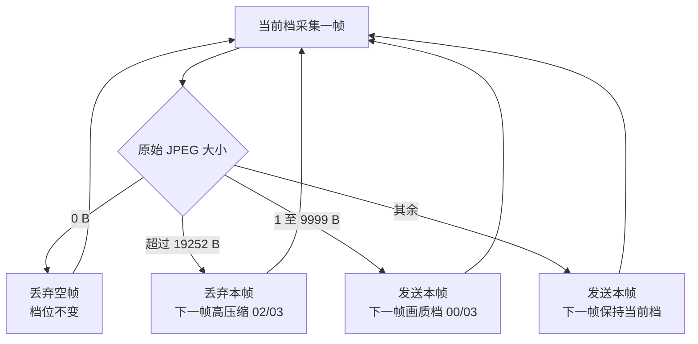

# TX 动态 JPEG 压缩切换

适用工程：MCCE、SBCE 的胶囊 TX。CX93510 采集分辨率保持 480×480，色度量化表固定为 `JPEG_ENC_DCT_CH=0x03`，只切换亮度量化表。

| 本帧原始 JPEG 大小 | 本帧处理 | 下一帧亮度表 |
|---|---|---|
| 大于 19252 B | 丢弃，不发送 BEGIN/DATA/END | 高压缩 `0x02` |
| 大于 0 B 且小于 10000 B | 正常发送 | 画质档 `0x00` |
| 10000～19252 B（含边界） | 正常发送 | 保持当前档 |

上电默认画质档 `0x00/0x03`。空帧丢弃且不切档。有效帧采集完成后只设置下一帧档位；CX93510 在下一次上电初始化时写入量化表并回读校验。不在本帧补拍。19252 B 是当前 STM 固定记录和 JPEG 头替换约束下的 TX 硬上限；超过上限的帧始终拒绝发送。

联调时查看 TX 的 `CX93510 configured ... DCT=00/03` 或 `DCT=02/03` 日志，核对切档；同时检查超限帧有拒发日志，后续合格帧产生 BEGIN/DATA/END 并在 RX 收到完整图像。

