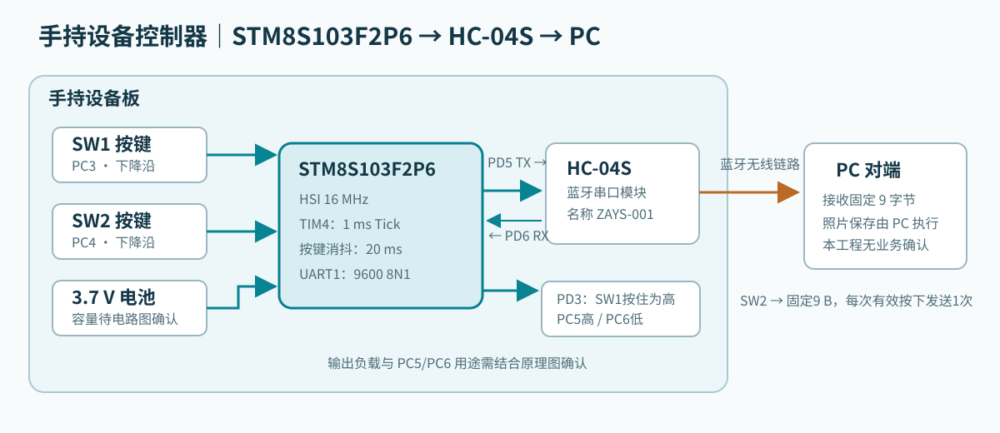
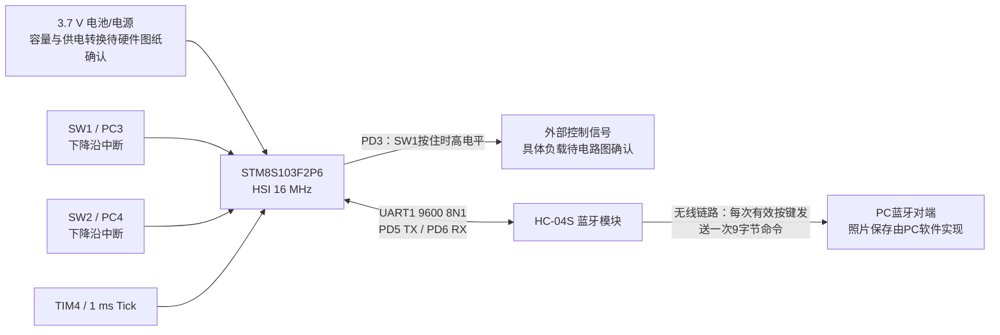
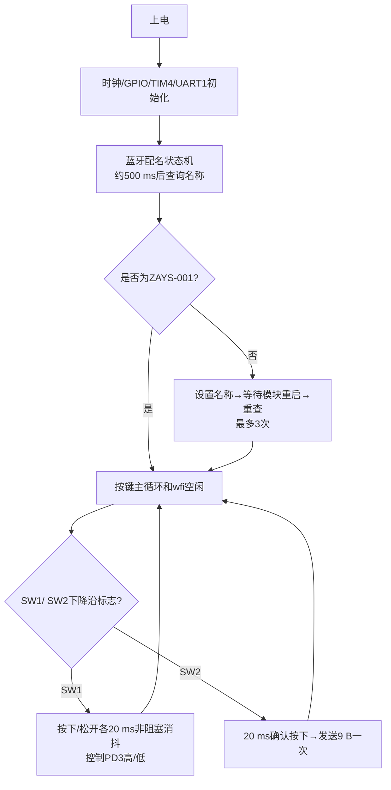

# 手持设备控制器（STM8S103F2P6）

本页按 `stm8sf2p6_project` 当前源码记录，不把蓝牙对端 PC 软件的预期行为写成已经由本固件实现的功能。系统总协议见[根目录当前工程通信协议](../磁控胶囊内窥镜系统通信协议-当前工程.md)。

## 1. 模块框图





电池电压按当前硬件信息标为 3.7 V；电池容量、供电转换方式仍需原理图确认。PC5 初始化为高电平、PC6 初始化为低电平，但代码没有说明它们连接的外部器件；图中未擅自标注为电源使能或指示灯。

## 2. 当前功能与引脚

| 部分 | 当前源码行为 |
| --- | --- |
| MCU/时钟 | STM8S103F2P6；HSI 不分频，16 MHz |
| TIM4 | 128 分频、自动重装 124，产生约 1 ms Tick；主循环据此推进蓝牙配置和按键消抖，空闲时执行 `wfi()` |
| UART1 | PD5 TX、PD6 RX；9600 bit/s、8 数据位、无校验、1 停止位；收发均使能 |
| SW1 | PC3，上拉输入、PORTC 下降沿中断；按下、松开均做非阻塞 20 ms 消抖，确认按住时 PD3 高，确认松开后恢复低 |
| SW2 | PC4，上拉输入、PORTC 下降沿中断；按下、松开均做非阻塞 20 ms 消抖；一次有效按下发送一次固定命令，长按不会连续发送 |
| PC5 / PC6 | 推挽输出；初始化后 PC5 高、PC6 低；外部用途需结合原理图确认 |
| 蓝牙名称 | 上电约 500 ms 后查询 `AT+NAME=?`；目标为 `ZAYS-001`，不匹配时最多设置/重查 3 次；配置按主循环状态机推进，不阻塞 SW1；SW2 在配置结束前不发送业务命令 |

## 3. SW2 发送的命令

当前代码把下面 9 B 常量直接写到 UART1，经过 HC-04S 发给蓝牙对端：

```text
FF 55 12 34 50 00 01 00 00
```

按帧外观可分为 4 B 固定前缀、命令 `50`、2 B 长度 `00 01`、1 B 数据 `00` 和末尾 `00`。但手持工程只发送固定数组，不解析长度或计算校验；末字节的业务定义及 PC 端是否实际按此格式解析，仍需与上位机代码或联调日志核对。该报文与胶囊图像链路的 `FF 55 12 34 81`、PC→RX 的 `ZAYS 2C` 都不是同一命令。

SW2 每次有效按下只发送上述 9 B 一次，长按不会重复发送；松开并再次按下后才会产生新的发送事件。当前没有 PC 业务确认、成功提示或断链检测；固件不自动重试，照片是否保存由 PC 软件决定。

## 4. 运行流程



## 5. 已实施的优化与后续待办

已实施：蓝牙 AT 配名改为非阻塞状态机；按下/松开均采用 20 ms Tick 消抖；主循环空闲执行 `wfi()`；UART 接收缓存扩到 32 B，记录溢出/接收错误，完整应答在主循环取走前不被新字节覆盖；SW2 每次有效按下只发送一次命令。

仍待确认或联调：

1. **业务闭环：**没有 PC 保存确认；当前固件只负责单次发送，无法判断照片是否保存成功。
2. **蓝牙接收：**当前仍以 UART IDLE 划分一段 AT 应答。若目标名称被拆成多段应答，代码会等到超时再重新配置；需用实机日志确认模块行为。
3. **硬件语义：**PD3、PC5、PC6 外接负载与 3.7 V 电池到各器件的供电转换，应以原理图核准。

## 6. 源码入口与验证建议

| 文件 | 查看重点 |
| --- | --- |
| `USER/main.c` | 初始化顺序、蓝牙配名、SW1/SW2 主循环、固定 9 B 命令 |
| `USER/stm8s_it.c` | PORTC 外部中断、UART1 RX/IDLE、TIM4 Tick |
| `BSP/bsp_uart.c/.h` | UART1 参数、阻塞发送、32 B 接收缓存和错误标志 |
| `BSP/bsp_delay.c/.h` | TIM4 1 ms 基准；`Delay_ms()`仍保留，但主循环不再调用 |

建议分别验证：上电蓝牙名称已正确/需修改/模块无响应；配置期间 SW1 可用且 SW2 不误发；SW1 按住与松开；SW2 连按、长按与消抖边界；每次有效按下仅发送一帧 9 B；蓝牙断开时发送；PC 接收与保存结果。当前未完成硬件联调和 IAR 构建验证。
